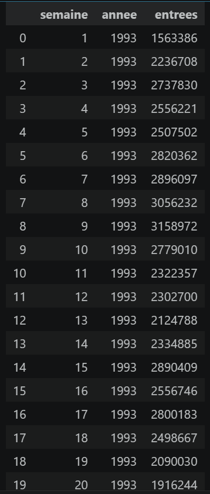
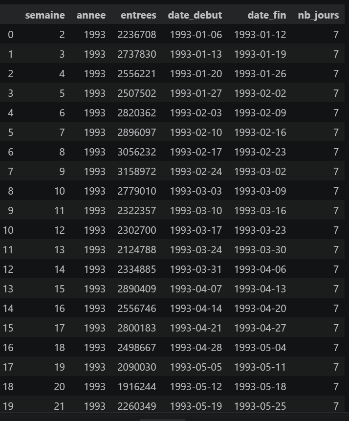
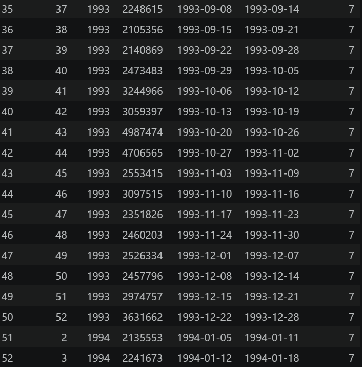
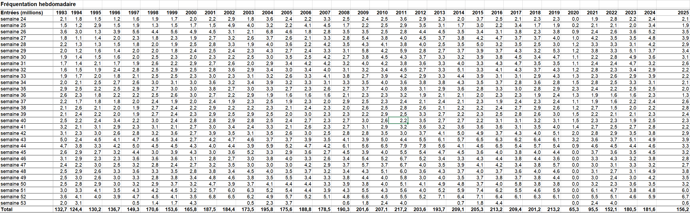

### nrows = la répétition | skiprows = nb de ligne sauté
### Nécessaire afin de prendre seulement les données nécessaires

cnc = pd.read_excel(
    "../data/raw/cnc_frequentation.xlsx",
    sheet_name="semaine",
    skiprows=6,
    nrows=54,
)
cnc.head()

### On transforme le tableau afin d'avoir une meilleur lisibilité des données

### On a remarqué un décallage dans les jours, donc on va néttoyer les données et confirmé le nombre de jours 
### dans le semaines avec un 7 

### Tableau d'origine

### Pourquoi les nombres affichés dans Excel ne sont-ils pas les mêmes que dans pandas ?

Les valeurs sont identiques ; seul l'**affichage** diffère. Le CNC stocke le nombre exact d'entrées (ex. : 1 563 386) mais applique dans Excel un format qui l'affiche **en millions, arrondi à une décimale** (1,6). C'est pour cela que l'en-tête indique « Entrées (millions) ».

### Pourquoi le tableau commence-t-il parfois à la semaine 2 et parfois à la semaine 1 ?

Parce que nous ne gardons que les **semaines complètes de 7 jours**. Selon le jour où tombe le 1ᵉʳ janvier, la semaine 1 est complète ou non :

| 1ᵉʳ janvier | Semaine 1 | Durée | Gardée ? |
|---|---|---|---|
| Mercredi | du 1ᵉʳ au 7 janvier | 7 jours | ✅ |
| Jeudi | du 1ᵉʳ au 6 janvier | 6 jours | ❌ |
| Vendredi | du 1ᵉʳ au 5 janvier | 5 jours | ❌ |
| Samedi | du 1ᵉʳ au 4 janvier | 4 jours | ❌ |
| Dimanche, lundi ou mardi | du premier mercredi au mardi suivant | 7 jours | ✅ |

> Exemple : en 1993, le 1ᵉʳ janvier tombe un vendredi. La semaine 1 ne dure que 5 jours (du 1ᵉʳ au 5 janvier) : elle est retirée, et le tableau commence à la semaine 2.

Pour la même raison, la **semaine 52** est parfois coupée au 31 décembre et retirée.

**Pourquoi c'est important :** une semaine de 5 jours compte mécaniquement moins d'entrées qu'une semaine de 7 jours. Si on la gardait, le modèle confondrait « moins de jours » avec « moins de spectateurs ».

Au total, **21 semaines incomplètes** sont retirées, en plus des semaines 0 et 53.

### Que se passe-t-il pour la période du Covid en 2020 et 2021 ?

Les cinémas ont été fermés plusieurs mois en 2020 et 2021. Dans le fichier du CNC, ces semaines sont de deux sortes :

| Situation | Dans le fichier | Exemple |
|---|---|---|
| Fermeture totale | Case vide (`NaN`) | Printemps 2020 |
| Fermeture partielle | Très petits nombres | 210 entrées en semaine 20 de 2020, 59 en semaine 1 de 2021 |

En temps normal, une semaine compte entre 2 et 5 millions d'entrées. Ces valeurs sont réelles, mais elles ne reflètent pas un fonctionnement normal des cinémas : elles fausseraient le modèle.

**Notre choix :** nous **conservons les semaines de 2020 et 2021 avec leurs dates**, mais nous **vidons leurs entrées** (`NaN`). Cela permet :

- de garder une ligne du temps **continue**, utile pour les graphiques ;
- de rendre la période Covid bien **visible** dans l'exploration ;
- de retirer facilement ces semaines au moment d'entraîner le modèle, car scikit-learn n'accepte pas les valeurs manquantes.
