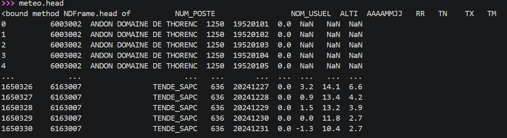

### Nous récupérons les colonnes qui nous intéresses

colonnes = ["NUM_POSTE", "NOM_USUEL", "ALTI", "AAAAMMJJ", "RR", "TN", "TX", "TM"]
meteo = pd.read_csv("data/raw/meteo/QUOT_departement_06_periode_1950-2024_RR-T-Vent.csv.gz", sep=";", usecols=colonnes)

### Permet de voir ce que nous avons

meteo.head

### Garde seulement les infos au dessus du 1er Janvier 1933 

meteo = meteo[meteo["AAAAMMJJ"] >= 19930101]

### Retire les colonnes mal renseigné et retire les données éloigné de la ville et non pertinentes

comptage = meteo.groupby(["NUM_POSTE", "NOM_USUEL", "ALTI"])["TX"].count()
comptage.sort_values(ascending=False).head(10)

### Résultat

NUM_POSTE  NOM_USUEL                  ALTI
6005001    ASCROS                     1173    11688
6029001    CANNES                     2       11688
6037002    CAUSSOLS                   1268    11688
6152002    VALBONNE-SOPHIA            238     11688
6088001    NICE                       2       11688
6083005    MENTON                     216     11688
6077006    PEIRA CAVA                 1443    11687
6163007    TENDE_SAPC                 636     11671
6079002    MANDELIEU LA NAPOULE_SAPC  104     11642

### Ici on va garder

6029001    CANNES                     2       11688
6152002    VALBONNE-SOPHIA            238     11688
6088001    NICE                       2       11688
6083005    MENTON                     216     11688
6079002    MANDELIEU LA NAPOULE_SAPC  104     11642

> **11 688 jours** correspond exactement à la période du 1er janvier 1993 au 31 décembre 2024 (32 ans, années bissextiles comprises). Une station à 11 688 n'a donc **aucun jour manquant**.

## 4. Stations retenues

| NUM_POSTE | Station | Altitude (m) | Jours renseignés |
|---|---|---|---|
| 6029001 | CANNES | 2 | 11 688 |
| 6152002 | VALBONNE-SOPHIA | 238 | 11 688 |
| 6088001 | NICE | 2 | 11 688 |
| 6083005 | MENTON | 216 | 11 688 |
| 6079002 | MANDELIEU LA NAPOULE_SAPC | 104 | 11 642 |

### Règle de sélection

1. **Complétude** : plus de 11 000 jours renseignés depuis 1993.
2. **Altitude** : moins de 300 m.

### Pourquoi ces critères ?

- **L'altitude** : dans les Alpes-Maritimes, la population vit principalement sur le littoral. Les stations de montagne (ASCROS, CAUSSOLS, PEIRA CAVA, TENDE) mesurent un climat très différent : il y fait en moyenne plusieurs degrés de moins qu'en ville. Elles fausseraient la météo vécue par les spectateurs.
- **La complétude** : le modèle a besoin d'une valeur météo pour chaque semaine. Une station avec beaucoup de jours manquants obligerait à inventer des valeurs.

## 5. Pourquoi plusieurs stations plutôt qu'une seule ?

- **Une seule station représente une ville, pas un département.** Une averse locale à Nice ne reflète pas forcément la météo de Cannes ou de Menton. La moyenne de plusieurs stations donne une image plus fidèle du département.
- **Robustesse face aux données manquantes.** Si une station n'a pas de mesure un jour donné, la moyenne est calculée avec les stations restantes : on n'a pas de trou dans les données.

On calculera donc, pour chaque jour, la **moyenne des stations retenues** afin d'obtenir une seule valeur par département.
